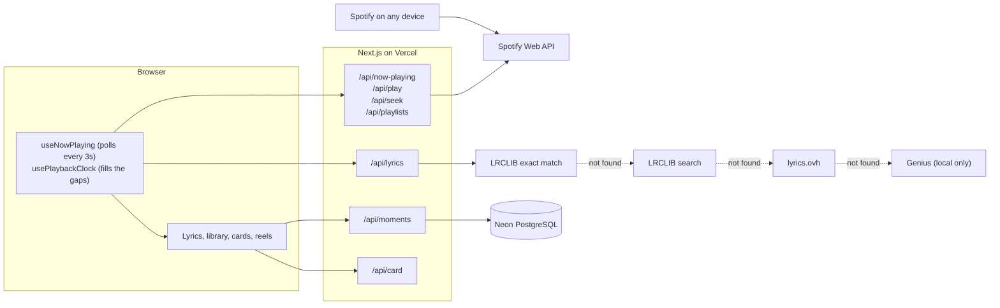

# Lyriq

Live, word-by-word lyrics for whatever's playing on Spotify, built for me: someone who wants to follow along with every song and keep the lines that hit.

**Author:** Elian Echavarria · **Course:** CMP 464/343 Product 1 · **Last updated:** November 2, 2026

**Live:** https://lyric-plum.vercel.app · jump to [Demo](#demo)

---

## 1. About Me (the User)

I'm a Spotify Premium listener and a CS student who is learning TypeScript. I usually listen through my phone speaker, and sometimes on my Mac. I want to follow the words of what I'm playing, and I care how that looks.

**The last 3 times this happened:**

1. **Sep 10, testing my first synced version:** the singer would sing a line, and the display only reached it a moment later. I was reading behind the song, which defeats the point. So I built a clock that estimates the song's position between Spotify updates.
2. **Sep 27, testing word-by-word highlighting:** it was still a little behind the voice, and a word sweep only feels right if it lands with the singing. I kept tuning, and added an adjustable timing offset that defaults to 650ms.
3. **Oct 3, listening on my Mac:** I tapped a line I'd saved to hear it again, and Spotify just sat empty and paused instead of switching to the song, so I couldn't get back to that moment. I compared polling logs, found that the Mac app ignores bare song requests, and fixed it by playing the song inside its album.

**What it costs me:**

- ⏱️ **Time:** every song that shows no lyrics means leaving what I'm doing and switching apps to look for them.
- 💸 **Money:** I already pay for Spotify Premium. Getting Apple Music's word-by-word lyrics would mean paying for a second music subscription.
- 🔋 **Energy:** switching between apps is friction, and it pulls my attention away from the song.
- 🙂 **Joy:** plain lyrics that lag behind the singer, or no lyrics at all, make it harder to get into a song I love.

---

## 2. Problem Statement

**Gut check:** I need lyrics that move with the song, for every song I play, because some songs on Spotify show no lyrics at all, and the ones that do don't have the beautiful word-for-word display Apple Music has.

**Five Whys:**

1. **Why** can't I follow along with a song? The lyrics in front of me are plain, or there are none.2. **Why** does that matter? I lose my place and can't tell which word is being sung.3. **Why** can't I just use what Spotify shows? It highlights whole lines, not words, and many songs don't have synced lyrics.4. **Why** don't other sources fill the gap? They're separate pages with static text that doesn't know where I am in the song.5. **Why** does nothing bring this together? The best display is locked to another subscription, and the widest lyric catalogs have no timing, so nothing joins my Spotify playback with timed lyrics from several sources.
**Problem statement:**

When I'm listening to a song on Spotify and want to follow the words, I struggle to see the right line at the right moment, and some songs show no synced lyrics at all, which costs me the time it takes to go find the words on every song that's missing them, and the joy of being inside the song. This happens because the lyrics I can see are either timed only by line or stored somewhere that has no idea what I'm playing. Right now I leave Spotify and look the words up somewhere else, but that text doesn't move with the music, and I lose my place and pull myself out of the song.

**I'll know this is solved when:** I can press play on any device and see the words light up in time with the singing, without searching, and when timed lyrics don't exist I still get the plain words without doing anything.

---

## 3. Existing Solutions

| What I use or tried | What it does well | Why it falls short for me |
| --- | --- | --- |
| Spotify's built-in lyrics | Already where I listen, and timed by line | No word-level highlighting, and not every song has synced lyrics |
| Apple Music lyrics | Beautiful word-by-word display, the look I wanted | Only works inside Apple Music, and my music is on Spotify |
| Genius | Huge catalog, plus annotations | Static text in a separate page, with no timing or link to what I'm playing |
| Musixmatch | Large catalog of synced lyrics | Its own product to install or pay for, and it couldn't be built on without a paid plan |

**The gap:** nothing gives me Apple Music-style word-by-word lyrics for my Spotify listening, falls back automatically when a song has no timing, and lets me keep the lines I love.

---

## 4. Features & Benefits

| Feature (what it does) | Benefit (how my life gets better) | MVP or Later? |
| --- | --- | --- |
| Mirrors what's playing on Spotify, on any device | Nothing to search for; lyrics appear when I press play | **MVP** |
| Synced lyrics with a word-by-word karaoke sweep | I always know exactly which word is being sung | **MVP** |
| Lyric fallback: LRCLIB exact match → LRCLIB search → lyrics.ovh → Genius | I still get words when a song has no timed lyrics | **MVP** |
| Album-art colors and cinema mode | It feels like the album, with nothing on screen but the words | Built beyond MVP |
| Tap a line to jump there | I can replay a line I missed | Built beyond MVP |
| Playlist shortcut | I can start music from the same screen | Built beyond MVP |
| Save moments, with a note and one-tap replay | I can get back to the exact second that hit me | Built beyond MVP |
| Share cards and short video reels | I can post a line without a screenshot | Built beyond MVP |

**MVP:** live mirroring, word-by-word synced lyrics, and automatic lyric fallback. That's the smallest version I'd actually use.

**Later:**

- On-screen timing control for phones (today the `[` and `]` adjustment needs a keyboard)
- Installable phone version that keeps the screen awake
- Karaoke scoring from the microphone
- Live listening rooms that friends can join
- Last.fm support, for listeners who aren't on Spotify

**Not doing:**

- **Apple Music support:** requires a paid developer membership
- **AI features:** the problem is timing and display, and AI doesn't help with either
- **Playing audio inside Lyriq:** it mirrors the Spotify I already use
- **Audio in reels:** Spotify's audio can't be captured, so reels are visual only
- **Musixmatch as a source:** it has no free plan
- **ffmpeg.wasm:** the browser can record MP4 by itself, so I avoided a heavy download
- **A public launch:** Spotify limits apps like this to a short list of approved accounts

---

## 5. Tech Stack

### Front end

- **Surface:** Web
- **Tools:** Next.js 16 (App Router), React 19, TypeScript in strict mode, Tailwind CSS 4
- **Why:** I listen on different devices, and a web page works on my phone and laptop with nothing to install. TypeScript is also what I'm here to learn.

### Back end

| Piece | Choice | Why |
| --- | --- | --- |
| Server / API | Next.js route handlers | The Spotify client secret must stay on a server, and Genius pages can't be fetched from a browser. This keeps one repo and one deploy instead of two apps. |
| Sign-in | Auth.js v5 with JWT sessions | It has a Spotify provider, and it's where hourly token refresh happens |
| Data storage | PostgreSQL (Neon) with Prisma | Saved moments have to survive across devices, and Prisma gives me typed queries |
| Outside services | Spotify Web API, LRCLIB, lyrics.ovh, Genius | Spotify says what's playing; LRCLIB has free timed lyrics; lyrics.ovh is the plain-text backup in production; Genius only works when I run it locally, because its song pages return 403 to Vercel's servers |
| Hosting / deploy | Vercel | Built for Next.js, and it deploys on every push to `main` |

### Architecture sketch



**One action, start to finish: tapping Save on a moment**

1. I select up to 4 lines and tap **Save**. `SelectionBar` sends the lines, their timing and my note to `POST /api/moments`.
2. The route calls `auth()` to find out who I am, and validates the input.
3. Prisma stores the row in Neon, tied to my Spotify user ID.
4. The library loads it back through `GET /api/moments`, 20 at a time, only ever for my user ID. Closing the page loses nothing.

**Where the data lives**

| Data | Where | What happens when I close the page |
| --- | --- | --- |
| Saved moments | PostgreSQL | Kept |
| Sign-in and Spotify tokens | Encrypted session cookie | Kept until it expires |
| Timing adjustment | `localStorage`, per browser | Kept |
| Fetched lyrics | Server memory | Re-fetched when the server restarts |

---

## 6. Open Questions

- **Timing on phones:** the 650ms default was tuned on my own setup. Is it right for other devices and for Bluetooth headphones, given that phones can't adjust it yet?
- **Genius in production:** the search API works from Vercel, but the song pages return 403 there, so Genius only helps when I run Lyriq locally. I added lyrics.ovh instead of trying to get around the block. Should I replace Genius completely, or use its search to link out to the song page?
- **Lyric cache:** it lives in server memory, so it empties on every serverless restart. Would a database cache be worth it?
- **Word timing:** most sources only time whole lines, so word timing is usually an even estimate. How far off can it get before it feels wrong?
- **Sharing:** Spotify's approved-accounts limit means I add each friend by hand. How far can this go without an organization account?

---

## Demo

**Live link:** https://lyric-plum.vercel.app

> Spotify only allows approved accounts to sign in to this project. If you'd like to try it, send me your Spotify email and I'll add you. Otherwise you'll see a "Server error" page after signing in.

<!-- Add your screenshots and video here, then delete this comment:


[Demo video](YOUR-UNLISTED-LINK)
-->

## Run it locally

```bash
npm install
npx prisma migrate dev
npm run dev
```

Open http://127.0.0.1:3000 (not `localhost`, which Spotify rejects). Create `.env.local` with `AUTH_SECRET`, `AUTH_URL`, `AUTH_REDIRECT_PROXY_URL`, `SPOTIFY_CLIENT_ID`, `SPOTIFY_CLIENT_SECRET`, `GENIUS_ACCESS_TOKEN` and `DATABASE_URL`. Secrets are never committed.
